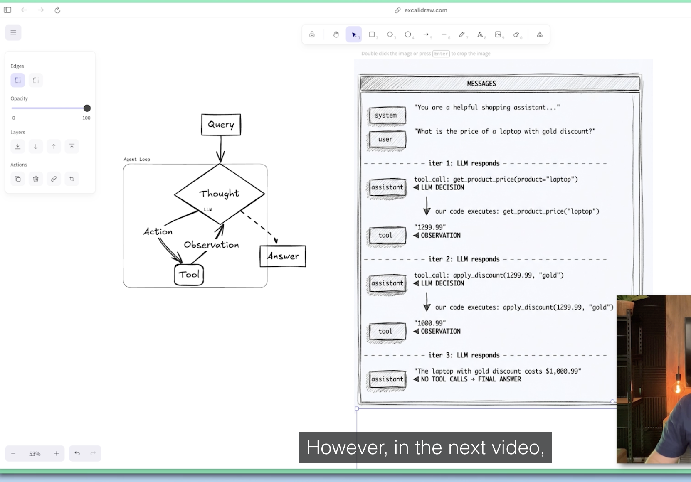

# Chapter: Agents Under the Hood

- ReAct Agent: Reasoning, Action, Thought
- ReAct Paper: https://arxiv.org/abs/2210.03629 `Synergizing Reasoning and Acting in Language Models`
- ReAct Agent Loop
  
- _Ollama_ CLI
    - $ ollama list - shows models running on your machine
    - $ ollama pull <model name str from ollama site>
    - $ ollama run <model name>
    - $ ollama delete <model name>
    - $ ollama serve - makes the model available to consume from our application running on the machine.

## Commit Walkthrough

Follow these commits in order to build the agent loop step by step.

| #   | Commit                                                                                                | Step                           |
| --- | ----------------------------------------------------------------------------------------------------- | ------------------------------ |
| 1   | [`d2494f6`](https://github.com/akhr/langchain-course/commit/d2494f6840195bcd6b905d42c894ab94ce0ced8e) | Define the tools               |
| 2   | [`59de2ea`](https://github.com/akhr/langchain-course/commit/59de2ea22fea3d2ebc2b301f735f500e13bed638) | Bind the tools to the LLM      |
| 3   | [`ae7f696`](https://github.com/akhr/langchain-course/commit/ae7f696463a4335e67c5d0d6ba87344f5c7aacfe) | Implement the agent loop       |
| 4   | [`4d9a66c`](https://github.com/akhr/langchain-course/commit/4d9a66ced0cd25118ec47d9c8383694d3a9ef6b1) | Swap models, harden the prompt |
| 5   | [`a916995`](https://github.com/akhr/langchain-course/commit/a916995c1b7eea98b3d4c5dc1123ba5d0a51f702) | Same loop without LangChain    |
| 6   | [`bd376eb`](https://github.com/akhr/langchain-course/commit/bd376eb43cdf47137b40ab81805db6e6fb1c48ed) | Raw ReAct prompt, no tool API  |

### 1. Define the tools — [`d2494f6`](https://github.com/akhr/langchain-course/commit/d2494f6840195bcd6b905d42c894ab94ce0ced8e)

Gives the agent its capabilities. No LLM wiring yet.

- Adds `01_agent_loop_langchain_tool_calling.py`
- `@tool get_product_price` — looks up a product in the catalog
- `@tool apply_discount` — applies a bronze / silver / gold tier

### 2. Bind the tools to the LLM — [`59de2ea`](https://github.com/akhr/langchain-course/commit/59de2ea22fea3d2ebc2b301f735f500e13bed638)

Registers the tools so the model receives their JSON schemas. The loop body is still empty.

- `tools` list and `tools_dict` (name → tool) for dispatch
- `init_chat_model("ollama:...", temperature=0.0)`
- `.bind_tools()` — without this, the model never sees the tool signatures

### 3. Implement the agent loop — [`ae7f696`](https://github.com/akhr/langchain-course/commit/ae7f696463a4335e67c5d0d6ba87344f5c7aacfe)

The core lesson: the full ReAct cycle.

- System prompt stating the tool rules
- Loop up to `MAX_ITERATIONS`, invoking the model each pass
- Inspect `tool_calls` — empty means the model is done
- Dispatch through `tools_dict`, then append `AIMessage` + `ToolMessage` to feed results back
- Both tools now return `str` instead of `float`
- Pins `.python-version` to `3.13.15`

### 4. Swap models, harden the prompt — [`4d9a66c`](https://github.com/akhr/langchain-course/commit/4d9a66ced0cd25118ec47d9c8383694d3a9ef6b1)

Tests the loop against different local models.

- Adds commented alternates: `llama3.1:latest`, `gemma3:270m`
- Prompt now demands strict tool ordering and exact price pass-through

### 5. Same loop without LangChain — [`a916995`](https://github.com/akhr/langchain-course/commit/a916995c1b7eea98b3d4c5dc1123ba5d0a51f702)

Rebuilds the identical agent straight against the Ollama client, so you can see
what `@tool` and `bind_tools()` were doing for you.

- Adds `02_agent_loop_raw_function_calling.py`
- Tool JSON schemas written by hand instead of generated from type hints
- LLM calls traced manually with `@traceable` for LangSmith
- Tool calls read via attribute access (`tool_call.function.name`) rather than dict access
- Messages are plain dicts, and the assistant turn must be appended whole to keep its `tool_calls`

### 6. Raw ReAct prompt, no tool API — [`bd376eb`](https://github.com/akhr/langchain-course/commit/bd376eb43cdf47137b40ab81805db6e6fb1c48ed)

Strips away tool calling entirely. The model never receives a tool schema — the
ReAct format is described in plain English and its replies are parsed with regex.
This is what LangChain's agents did before native function calling existed.

- Adds `03_raw_react_prompt.py`
- Tool descriptions built at runtime from `inspect.signature` + docstrings
- Prompt teaches the `Thought / Action / Action Input / Observation` cycle
- Replies parsed with `re.search(r"Action:\s*(.+)")` — fragile if the model drifts
- `stop: ["\nObservation"]` halts generation so the model can't hallucinate results
- History is one growing `scratchpad` string re-sent each turn, not a message list
